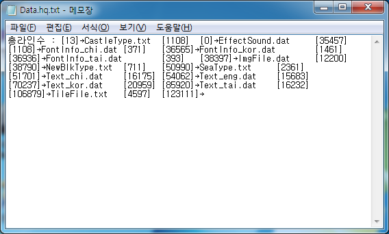

# HQ Packer

[English](README.md)

천년의신화, 임진록2, 임진록2+ 가 게임 데이터를 묶어 두는 `Data.hq` 와 `Data` 한 쌍을 풀고 다시 묶는 프로그램이다. 두 파일은 바이트마다 같은 변환을 걸어 암호화되어 있다. `Data.hq` 는 파일 이름과 크기, 오프셋을 적은 헤더이고 `Data` 는 파일 내용을 이어 붙인 본체다. 풀면 `unpacked/` 폴더에 원래 이름으로 낱개 파일이 나오고 고친 뒤 다시 묶으면 게임이 그대로 읽는 한 쌍이 된다. 포맷 분석은 [docs/hq-format.ko.md](docs/hq-format.ko.md) 에 있다.

<p>
  
</p>


## 사용 방법

Releases에서 받아 압축을 푼 뒤 실행 파일을 게임 폴더의 `Data.hq` 와 `Data` 옆에 두고 실행하면 "Do you want packing?" 물음이 뜬다.

- **아니오** 를 고르면 푼다. `unpacked/` 폴더에 낱개 파일이 생기고 파일 목록이 `unpacked.info` 에 남는다. 원래의 `Data.hq` 와 `Data` 는 지워진다.
- **예** 를 고르면 묶는다. `unpacked.info` 의 목록 순서대로 `unpacked/` 의 파일을 이어 붙여 `Data.hq` 와 `Data` 를 새로 만들고 `unpacked/` 폴더와 `unpacked.info` 를 지운다.

풀기 전에 원본 두 파일을 따로 복사해 두는 것이 안전하다. 끝나면 Completed! 메시지가 뜨고 종료된다.


## 구현 원리

**암호화는 바이트마다 0x10 비트를 뒤집는 것이다.** 두 파일 모두 바이트를 읽어 그 비트가 켜져 있으면 16 을 빼고 꺼져 있으면 16 을 더한다. 같은 변환을 한 번 더 걸면 원래대로 돌아오므로 풀기와 묶기가 같은 변환을 쓴다. 아래는 묶을 때 헤더(`i=0`)와 본체를 암호화하는 부분이다.

```gml
byte = file_bin_read_byte(file)
if(i=0)
{
    if(byte=45){byte=29}
    if(byte=62){byte=26}
}
if(byte & 16)
{
    file_bin_write_byte(file2, byte-16)
}
else
{
    file_bin_write_byte(file2, byte+16)
}
```

**헤더는 문자열 함수로 자른다.** 풀어낸 `Data.hq` 는 `총라인수 : [파일 개수]` 뒤에 `파일 이름<TAB>[크기]<TAB>[오프셋]` 항목이 이어지는 한 줄짜리 텍스트다. 암호화된 파일에서 항목 사이는 `0D 0A` 두 바이트인데 변환을 걸면 제어 문자 `1D 1A` 가 되어 다루기 어렵다. 그래서 풀 때는 이 자리를 `->` 로 바꿔 두고 `string_pos` 로 `->`, 탭, 대괄호를 찾아 이름과 크기, 오프셋을 읽는다. 묶을 때는 위 코드처럼 `-` 와 `>` 를 29 와 26 으로 바꾼 뒤 변환을 걸어 다시 `0D 0A` 로 되돌린다.

**본체는 오프셋에서 크기만큼 잘라 낸다.** `Data` 에는 파일 내용이 헤더 순서대로 이어 붙어 있어 첫 파일의 오프셋이 0 이다. 파일마다 오프셋으로 이동해 크기만큼 바이트를 복사하고 이름에 폴더가 들어 있으면 `unpacked/` 아래에 그 폴더를 만든다. 묶을 때는 `unpacked.info` 의 순서대로 크기를 재서 오프셋을 누적하며 헤더를 새로 쓰고 내용을 이어 붙인 뒤 두 파일을 같은 변환으로 암호화한다.


## 파일

| 경로 | 내용 |
|---|---|
| `source/hq-packer.gmk` | 원본 프로젝트 파일 |
| `source/split/` | GmkSplitter로 분해한 텍스트 트리 |
| `docs/hq-format.ko.md` | HQ 포맷 분석 |
| `docs/screenshots/` | 스크린샷 |
| Releases | 실행 파일과 사용 설명 |


## 라이선스

zlib 라이선스다. 자세한 내용은 [LICENSE](LICENSE) 에 있다.
